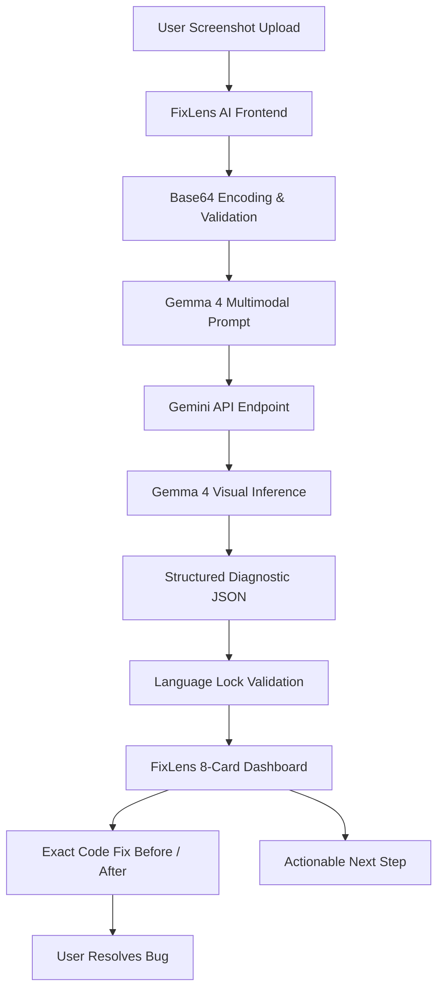

# 🔎 FixLens AI

### See the Problem. Understand It. Fix It.

**FixLens AI** is a multimodal AI-powered visual debugging assistant built for developers, students, and engineers. It allows users to upload screenshots of programming errors, terminal crashes, IDE outputs, and compiler tracebacks, and uses **Gemma 4** through the Gemini API to understand the visual information, identify the actual error, explain the cause, provide a language-preserving code repair, and suggest the actionable next step.

Unlike generic chatbots or static error dictionaries, FixLens AI dynamically inspects the **actual image** uploaded by the user—extracting visible code lines, line numbers, variable names, and error logs directly from pixel data.

---

## 🏆 Built for the Gemma 4 Hackathon

FixLens AI was created for the **MLH × DEV × React Hyderabad Hack Day** challenge: **Best Use of Gemma 4**.

The project demonstrates a focused, multimodal AI workflow:

```
User Screenshot ➔ Gemma 4 Multimodal Understanding ➔ Error Detection ➔ Cause Identification ➔ Exact Fix ➔ Next Action
```

Gemma 4 is meaningfully responsible for the visual comprehension step—reading code snippets and terminal outputs directly from screenshots to convert trapped visual problems into instant solutions.

---

## 🎯 Problem

Programming errors are frequently trapped inside screenshots—shared on Slack, Discord, Stack Overflow, GitHub Issues, or captured during live coding sessions. When an error occurs, developers and students often struggle to pinpoint the exact line, understand cryptic compiler messages, or determine the immediate next step.

Traditional debugging requires manually re-typing error messages and searching through documentation. Generic text chatbots require copy-pasting code context that may not even be in text format.

**FixLens AI** solves this by letting users simply drop a screenshot and receive an instant, structured diagnosis.

---

## 💡 Solution

FixLens AI provides a streamlined, single-purpose debugging workflow:

1. **User uploads an error screenshot** (PNG, JPG, WEBP, or clipboard paste).
2. **FixLens converts the current image** into base64 data and sends it with a structured prompt.
3. **Gemma 4 analyzes the visual content**, detecting the programming language, error type, and line numbers.
4. **Identifies the exact failure**: Isolates the problematic statement in the user's code.
5. **Explains the root cause**: Details why the issue occurred in the user's specific context.
6. **Generates a language-preserving correction**: Fixes the error in the **SAME** programming language (Python remains Python, JavaScript remains JavaScript).
7. **Explains why the fix works**: Details the language-specific technical rationale.
8. **Provides an actionable next step**: Gives a clear instruction on what to do next to get back to coding.

When a new image is selected, previous results are immediately cleared to ensure that every diagnosis is fresh and dynamic.

---

## ✨ Key Features

- 🖼️ **Multimodal Screenshot Analysis**: Analyzes IDE windows, VS Code editors, terminal stack traces, compiler output, and browser consoles directly from images.
- 🤖 **Gemma 4 Powered Visual Understanding**: Ingests image pixels via the Gemini API to understand layout, line numbers, and error messages.
- 🔍 **Exact Error Identification**: Distinguishes between `SyntaxError`, `IndentationError`, `NameError`, `TypeError`, `ModuleNotFoundError`, Java compilation errors, and more.
- 💻 **Programming Language Detection**: Identifies Python, JavaScript, TypeScript, Java, C/C++, Rust, Go, and locks the solution to that language.
- 📍 **Problem Location & Line Identification**: Pinpoints the exact line number and extracts the problematic code snippet (`BEFORE`).
- 🧩 **Actual Cause Explanation**: Specific, non-generic technical explanation referencing the user's actual code.
- 🛠️ **Language-Preserving Code Correction**: Generates syntactically valid code in the original language (`AFTER`).
- 🔄 **Dynamic Analysis per Upload**: Fresh API inference for every uploaded image with `AbortController` protection against stale responses.
- 📋 **One-Click Copy Fix**: Instantly copies the corrected code with celebration confetti feedback.
- 📝 **Step-by-Step Checklist**: Actionable steps users can interactively check off.
- 🎯 **Actionable Next Step (Understand ➔ Act)**: Direct guidance on what command to run or action to take next.
- 📊 **Confidence Indication**: Displays model-reported confidence (High / Medium / Low).
- ⚠️ **Clear Handling of Unclear Screenshots**: Gracefully informs the user if a screenshot is too blurry or cropped rather than guessing.
- 🎨 **Orange & Dark Charcoal Developer UI**: Clean glassmorphism aesthetic with responsive layouts and glowing accents.
- 📱 **Fully Responsive**: Optimized for desktop, laptop, tablet, and mobile browsers.
- 🧪 **Seeded Demo Mode & Judge Speedrun**: Preconfigured presets (Python, JavaScript, Java) for fast hackathon demonstrations in under 2 minutes.

---

## ⚙️ How It Works

```
User
  │
  ▼
Screenshot Upload (File / Drag & Drop / Ctrl+V)
  │
  ▼
React Frontend (Validates & Encodes Base64)
  │
  ▼
Image + Multimodal Prompt
  │
  ▼
Gemma 4 / Gemini API Endpoint
  │
  ▼
Multimodal Visual Inference
  │
  ▼
Structured Diagnostic Schema
  │
  ▼
FixLens Result Cards (8-Section Dashboard)
  │
  ▼
Exact Fix + Next Action (User Acts)
```

1. **Input**: The user drops an error screenshot or clicks a demo preset.
2. **Encoding**: The browser File API reads and encodes the image into base64 payload.
3. **Inference**: Gemma 4 evaluates the visual code context via the Gemini API multimodal endpoint.
4. **Validation**: The frontend validates language lock integrity and parses structured JSON.
5. **Action**: FixLens displays the 8-card diagnosis dashboard with the copyable fix and next action.

---

## 🛠️ Tech Stack

### Frontend
- **Framework**: React 19 (`react`, `react-dom`)
- **Build Tool**: Vite 8 (`vite`, `@vitejs/plugin-react`)
- **Language**: JavaScript (ES Modules, JSX)
- **Styling**: Vanilla Modern CSS design system with CSS custom properties, glassmorphism, and responsive grid layouts (Orange Theme)
- **Icons**: Lucide React (`lucide-react`)
- **Effects**: Canvas Confetti (`canvas-confetti`)

### AI / Machine Learning
- **AI Model**: Gemma 4 (`gemma-4`, configurable via `VITE_GEMINI_MODEL`)
- **API**: Google Gemini API (`https://generativelanguage.googleapis.com/v1beta/models/`)
- **Integration**: Direct multimodal REST API communication with structured JSON schema enforcement
- **SDK**: `@google/generative-ai`

### Image Processing
- **Browser File API**: `FileReader`, `Blob`, `dataURL` / `base64` conversion
- **Clipboard API**: Global paste listener (`Ctrl+V` / `Cmd+V`)
- **SVG Canvas Generators**: In-memory high-resolution mock editor screenshot generation for demo presets

### State Management
- **React Hooks**: `useState`, `useRef`, `useEffect`
- **Concurrency Control**: `AbortController` and sequential request counters to prevent race conditions
- **Local Storage**: Browser `localStorage` for API key preferences and recent diagnosis history

### Backend & Storage
- **Architecture**: FixLens currently uses a frontend-driven architecture with direct AI API integration.
- **Database**: No database is required for the current prototype. All screenshot analyses occur in-memory, preserving user privacy.

### Development Tools
- **Version Control**: Git / GitHub
- **Package Manager**: npm
- **Linter**: Oxlint (`oxlint`)
- **IDE**: VS Code / Google Antigravity

---

## 📊 Tech Stack Table

| Layer | Technology | Purpose |
|---|---|---|
| **Frontend Framework** | React 19 | Reactive component-based user interface |
| **Build & Dev Tool** | Vite 8 | Fast HMR development server and optimized bundle build |
| **AI Model** | Gemma 4 (`gemma-4`) | Multimodal screenshot comprehension and code repair |
| **AI API** | Google Gemini API | REST endpoint for multimodal model communication |
| **Styling** | Modern CSS (CSS Tokens) | Custom dark charcoal & vibrant orange design system |
| **Icons & UI** | Lucide React | Visual icons and symbols |
| **Effects** | Canvas Confetti | Celebration feedback on code copy |
| **Image Processing** | Browser File API / FileReader | In-memory image encoding and clipboard capture |
| **State Management** | React Hooks (`useState`, `useRef`) | Local UI and asynchronous request state |
| **Local Persistence** | Web Storage API (`localStorage`) | Saves recent diagnoses and user settings locally |
| **Linting** | Oxlint | Fast JavaScript/JSX code quality inspection |
| **Version Control** | Git & GitHub | Source code management and collaboration |

---

## 🏗️ System Architecture



---

## ⚙️ Setup & Installation

### 1. Clone the repository
```bash
git clone https://github.com/your-username/fixlens-ai.git
cd fixlens-ai
```

### 2. Install dependencies
```bash
npm install
```

### 3. Configure Environment Variables
Create a `.env` file in the root directory (or copy from `.env.example`):
```bash
cp .env.example .env
```

Add your Gemini API key:
```env
VITE_GEMINI_API_KEY=your_gemini_api_key_here
VITE_GEMINI_MODEL=gemma-4
```

> **Note:** You can also enter or update your API key directly inside the app using the **Settings** modal in the top header, or test using the preconfigured **Demo Mode**.

### 4. Run Development Server
```bash
npm run dev
```
Open [http://localhost:5173](http://localhost:5173) in your browser.

### 5. Build for Production
```bash
npm run build
```

---

## 🧪 2-Minute Hackathon Demo Flow

1. Open FixLens AI in your browser.
2. Select the **Python SyntaxError** (`quicksort.py`) preset or upload an error screenshot.
3. Observe the live preview showing the exact code error.
4. Click **Analyze with Gemma 4**.
5. Watch the multimodal scanning animation.
6. Review the results:
   - **Detected Input**: `Python • SyntaxError • Line 22`
   - **Card 01**: Exact Error Detected
   - **Card 02**: What Exactly Is Wrong?
   - **Card 03**: Problematic code location
   - **Card 04**: Before ➔ After corrected Python code
   - **Card 05**: Technical rationale
   - **Card 06**: Step-by-step resolution
   - **Card 07**: **What Should You Do Next?**
7. Click **Copy Python Fix** (celebration confetti triggers).
8. Select a different preset (e.g. **JavaScript TypeError** or **Java Compilation Error**), observe that previous results clear immediately, and click Analyze to see a completely distinct, language-preserved diagnosis.

---

## 📄 License

MIT License — free for open-source and educational use.
